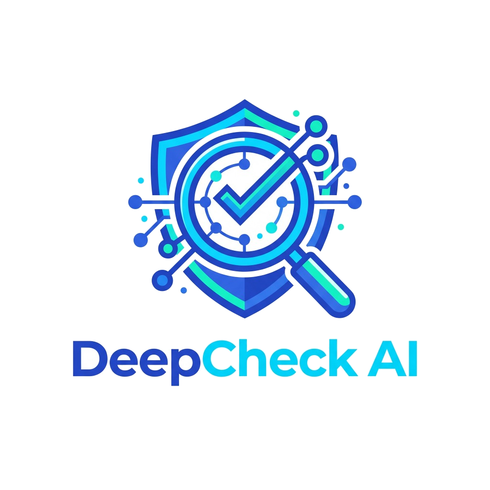

<div align="center">

  

  # DeepCheck AI
  ### Sistem Verifikasi Media & Deteksi Deepfake Berbasis Kecerdasan Buatan Multi-Jalur
  **"Saring Sebelum Sharing — Lawan Disinformasi Digital dengan Forensik AI"**

  [](https://nextjs.org/)
  [](https://react.dev/)
  [](https://tailwindcss.com/)
  [](https://aistudio.google.com/)
  [](https://vercel.com/)
  [](#lisensi)

  <p align="center">
    <b>Proyek Mata Kuliah PTIK (Pengantar Teknologi Informasi dan Komunikasi)</b><br />
    Program Studi Informatika • Kelompok 4
  </p>

</div>

---

## 📌 Daftar Isi
- [Tentang Proyek](#-tentang-proyek)
- [Masalah yang Diselesaikan](#-masalah-yang-diselesaikan)
- [Fitur Utama](#-fitur-utama)
- [Arsitektur Multi-Jalur (9 Routers)](#-arsitektur-multi-jalur-9-routers)
- [Teknologi & Dependensi](#-teknologi--dependensi)
- [Struktur Direktori](#-struktur-direktori)
- [Panduan Instalasi & Penggunaan Lokal](#-panduan-instalasi--penggunaan-lokal)
- [Konfigurasi Environment Variables](#-konfigurasi-environment-variables)
- [Panduan Deploy ke Vercel](#-panduan-deploy-ke-vercel)
- [Tim Pengembang](#-tim-pengembang)
- [Disclaimer & Etika AI](#-disclaimer--etika-ai)

---

## 📖 Tentang Proyek

**DeepCheck AI** adalah platform verifikasi keaslian informasi dan deteksi manipulasi konten digital (deepfake gambar, kloning suara, rekayasa video, dan teks narasi hoaks) yang dirancang khusus untuk kalangan mahasiswa, akademisi, dan masyarakat umum.

Dengan memanfaatkan orkestrator kecerdasan buatan multi-jalur (Google Gemini 2.5), sistem mengevaluasi integritas konten dari berbagai sudut pandang: **forensik visual artefak sintetis**, **analisis linguistik/urgensi hoaks**, dan **penelusuran silang ke basis data pemeriksa fakta resmi** (TurnBackHoax Mafindo, Kementerian Kominfo).

---

## 🎯 Masalah yang Diselesaikan

1. **Eksplosi Manipulasi AI:** Semakin mudahnya pembuatan foto sintetis realistis (Midjourney/DALL-E) dan video deepfake tokoh publik yang menyesatkan publik.
2. **Kloning Suara & Rekayasa Sosial:** Maraknya penipuan berkedok telepon darurat atau beasiswa yang meniru suara pimpinan kampus/pejabat.
3. **Format Hoaks Multi-Platform:** Informasi hoaks yang tersebar di WhatsApp, Instagram Reels, TikTok, dan X dengan format teks bercampur video pendek.
4. **Ketiadaan Konteks Cepat:** Masyarakat sering kali menyebarkan informasi tanpa menyaring karena ketiadaan alat verifikasi instan yang mudah dipahami dalam 60 detik.

---

## ⚡ Fitur Utama

- 🔗 **Pemeriksaan Multi-Input:**
  - **Tautan Media:** Mendukung verifikasi tautan Instagram Reels, TikTok, YouTube Shorts/Video, dan portal berita daring dengan resolver metadata cerdas.
  - **Unggah Berkas:** Mendukung Gambar (JPG, PNG, WEBP), Rekaman Video (MP4, WEBM), dan Suara (MP3, WAV) dengan kompresi *client-side* otomatis.
  - **Teks Narasi:** Analisis mendalam terhadap klaim tekstual, pesan berantai WhatsApp, dan rilis pers mencurigakan.
- 📡 **Real-Time Streaming SSE (Server-Sent Events):** Menampilkan tahapan analisis forensik secara langsung detik demi detik kepada pengguna.
- 🎛️ **Skor Keaslian Probabilistik (0–100%):** Dilengkapi *Radial Gauge Meter* interaktif dengan kategori risiko terukur (*Kritis, Tinggi, Waspada, Rendah, Aman*).
- 🧩 **4 Pilar Analisis Komprehensif:**
  1. *Forensik Visual & Audio (Artefak Sintetis / Deepfake)*
  2. *Pola Bahasa, Urgensi & Retorika Emosional*
  3. *Konsistensi Fakta & Basis Data Klarifikasi Resmi*
  4. *Integritas Kanal & Atribusi Sumber*
- 📤 **Kartu Debunk / Edukasi Satu-Klik:** Fitur *Bagikan Klarifikasi* yang memformat pesan debunk siap kirim ke grup WhatsApp lengkap dengan referensi fakta resmi.
- ⏱️ **Modul Literasi 60 Detik:** Panduan aksi cepat mahasiswa (*Saring Sebelum Sharing*) dan langkah kritis sebelum membagikan informasi.
- 📜 **Riwayat Pemeriksaan Sesi:** Rekap riwayat verifikasi lokal tanpa merekam data pribadi pengguna.
- 📱 **Desain Antarmuka Adaptif:** Tampilan responsif modern untuk Desktop dan Mobile yang bersih, elegan, dan ramah pengguna.

---

## 🧠 Arsitektur Multi-Jalur (9 Routers)

Sistem menggunakan alur orkestrasi dinamis 9-Router forensik:

```
[Input: URL / File / Teks]
           │
           ▼
   ┌───────────────┐
   │ R1: Intake    │ ➔ Validasi MIME, magic bytes, resolusi & sampling
   └───────┬───────┘
           │
           ▼
   ┌───────────────┐
   │ R2: Preprocess│ ➔ Normalisasi data, ekstraksi thumbnail & audio
   └───────┬───────┘
           │
 ┌─────────┴───────────────────────────────┐
 │ Pipeline Analisis Paralel               │
 ├─────────────────────────────────────────┤
 │ ➔ R3: OCR & Ekstraksi Klaim Gambar      │
 │ ➔ R4: Forensik Artefak Gambar Difusi    │
 │ ➔ R5: Temporal Motion & Deepfake Video  │
 │ ➔ R6: Deteksi Kloning & Suara Sintetis  │
 │ ➔ R7: NLP Pola Bahasa Hoaks & Urgensi   │
 │ ➔ R8: Verifikasi Silang Sumber Resmi    │
 └─────────┬───────────────────────────────┘
           │
           ▼
   ┌───────────────┐
   │ R9: Evaluasi  │ ➔ Kalibrasi skor tertimbang, mitigasi false positive,
   │     & Skor    │   dan perumusan kartu rekomendasi literasi
   └───────┬───────┘
           │
           ▼
[Output: Skor 0-100%, 4 Pilar, Rujukan Resmi & Debunk Card]
```

| Router | Nama | Deskripsi Tugas |
| :--- | :--- | :--- |
| **R1** | *Intake & Validation* | Memeriksa tipe data, sanitasi URL, dan validasi format media. |
| **R2** | *Preprocessing* | Menyiapkan buffer, mengekstrak pratinjau, dan mereduksi ukuran payload. |
| **R3** | *OCR & Claim Detection* | Membaca tipografi pada poster/tangkapan layar dan merumuskan klaim utama. |
| **R4** | *Image Artifacts* | Menemukan kejanggalan distorsi AI (tekstur kulit, geometri pencahayaan, simetri mata). |
| **R5** | *Video Deepfake* | Menganalisis inkonsistensi kedipan mata, desinkronisasi bibir, dan jitter temporal. |
| **R6** | *Audio Forensics* | Memeriksa spektrum suara datar, hilangnya desah napas alami, dan anomali sintetis. |
| **R7** | *NLP Language Pattern* | Mengidentifikasi gaya bahasa provokatif, *urgency trap*, dan logika manipulatif. |
| **R8** | *Official Cross-Check* | Membandingkan klaim dengan arsip TurnBackHoax, Kominfo, dan media kredibel. |
| **R9** | *Score Engine* | Menggabungkan temuan seluruh router dengan pembobotan adaptif dan kalibrasi risiko. |

---

## 🛠️ Teknologi & Dependensi

- **Core Framework:** [Next.js 16.4.2](https://nextjs.org/) (App Router & Turbopack)
- **Library UI:** [React 19.3.0](https://react.dev/)
- **Styling & Design System:** [Tailwind CSS v4](https://tailwindcss.com/)
- **Animasi & Interaktivitas:** [Framer Motion](https://www.framer.com/motion/)
- **Ikonografi:** [Lucide React](https://lucide.dev/)
- **Kecerdasan Buatan (LLM & Vision):** [Google Gen AI SDK (`@google/genai`)](https://www.npmjs.com/package/@google/genai) — Gemini 2.5 Flash Lite
- **Pengolah Gambar:** [Sharp](https://sharp.pixelplumbing.com/)
- **Validasi Skema:** [Zod v4](https://zod.dev/)
- **Platform Deployment:** [Vercel](https://vercel.com/) (Serverless Function Streaming)

---

## 📁 Struktur Direktori

```text
deepcheck/
├── public/                     # Aset publik statis (logo, logo-icon, favicon)
├── src/
│   ├── app/                    # Next.js 16 App Router
│   │   ├── api/
│   │   │   └── analyze/
│   │   │       └── route.ts    # Handler endpoint verifikasi (Streaming SSE)
│   │   ├── globals.css         # Styling tema Tailwind v4 & mesh gradients
│   │   ├── layout.tsx          # Root layout & konfigurasi meta
│   │   ├── page.tsx            # Halaman utama aplikasi (Single Page Dashboard)
│   │   └── suppress-devtools.tsx # Suppressor dev overlay Next.js
│   ├── components/             # Komponen antarmuka modular
│   │   ├── analysis-progress.tsx   # Visual progress indicator real-time
│   │   ├── footer.tsx              # Footer identitas akademik PTIK
│   │   ├── header.tsx              # Navbar & tombol riwayat
│   │   ├── history-drawer.tsx      # Laci riwayat sesi pemeriksaan
│   │   ├── literacy-card.tsx       # Modul literasi 60 detik "Saring Sebelum Sharing"
│   │   ├── media-input.tsx         # Tab formulir multi-input (URL, File, Teks)
│   │   ├── reason-card.tsx         # Rangkuman temuan & sumber rujukan resmi
│   │   ├── score-card.tsx          # Gauge skor keaslian & 4 pilar analitik
│   │   ├── verification-card-export.tsx # Modal kartu debunk & salin WhatsApp
│   │   └── ui/                     # Komponen UI atomik
│   ├── lib/                    # Utilitas & logika pendukung
│   │   ├── gemini.ts           # Inisialisasi Google GenAI SDK
│   │   ├── router-config.ts    # Konfigurasi model per router
│   │   ├── schemas.ts          # Skema Zod tipe respons terstruktur
│   │   ├── score-engine.ts     # Logika kalkulasi pembobotan pilar
│   │   ├── url-resolver.ts     # Metadata scraper untuk YouTube, IG, TikTok, Berita
│   │   └── utils.ts            # Formatter & helper fungsi Tailwind
│   └── routers/                # Implementasi 9-Router Forensik
│       ├── orchestrator.ts     # Orkestrator eksekusi pipeline
│       ├── r1-intake.ts ... r9-score-combine.ts
│       └── types.ts            # Tipe data router & progress event
├── .env.example                # Contoh format variabel lingkungan
├── eslint.config.mjs           # Konfigurasi ESLint flat
├── next.config.ts              # Konfigurasi Next.js 16
├── package.json                # Metadata paket & scripts npm
├── vercel.json                 # Konfigurasi timeout serverless Vercel
└── README.md                   # Dokumentasi resmi repositori
```

---

## 🚀 Panduan Instalasi & Penggunaan Lokal

### Prasyarat:
- **Node.js** versi 20.x atau 22.x+ (rekomendasi: LTS)
- **npm**, **yarn**, atau **pnpm**
- **Google Gemini API Key** (Dapat diperoleh gratis di [Google AI Studio](https://aistudio.google.com/app/apikey))

### Langkah-langkah:

1. **Clone Repositori:**
   ```bash
   git clone https://github.com/username-anda/deepcheck.git
   cd deepcheck
   ```

2. **Instal Dependensi:**
   ```bash
   npm install
   ```

3. **Atur Variabel Lingkungan:**
   Salin berkas `.env.example` menjadi `.env.local`:
   ```bash
   cp .env.example .env.local
   ```
   Buka berkas `.env.local` dan masukkan API key Gemini Anda:
   ```env
   GEMINI_API_KEY=AIzaSy...
   ```

4. **Jalankan Server Development:**
   ```bash
   npm run dev
   ```

5. **Buka di Browser:**
   Akses [http://localhost:3000](http://localhost:3000) pada peramban web Anda.

---

## 🔑 Konfigurasi Environment Variables

| Variabel | Wajib? | Deskripsi | Default |
| :--- | :---: | :--- | :--- |
| `GEMINI_API_KEY` | **Ya** | Kunci API dari Google AI Studio untuk akses model Gemini. | *-* |
| `R1_MODEL` | Tidak | Override model AI untuk Router 1. | `gemini-2.5-flash-lite` |
| `R7_MODEL` | Tidak | Override model AI untuk analisis teks/NLP (Router 7). | `gemini-2.5-flash-lite` |
| `R8_MODEL` | Tidak | Override model AI untuk cross-check sumber (Router 8). | `gemini-2.5-flash-lite` |
| `R9_MODEL` | Tidak | Override model AI untuk sintesis skor (Router 9). | `gemini-2.5-flash-lite` |

---

## ☁️ Panduan Deploy ke Vercel

Aplikasi ini sudah dilengkapi berkas `vercel.json` dan siap di-deploy langsung ke Vercel:

1. **Push ke GitHub:**
   ```bash
   git add .
   git commit -m "feat: siap rilis produksi"
   git push origin main
   ```
2. **Import ke Vercel:**
   - Kunjungi [Vercel Dashboard](https://vercel.com/) dan pilih **Add New Project**.
   - Pilih repositori `deepcheck` Anda.
3. **Set Environment Variable di Vercel:**
   - Buka menu **Environment Variables**.
   - Tambahkan nama `GEMINI_API_KEY` dengan nilai API key Anda.
4. **Klik Deploy:**
   - Vercel akan otomatis menjalankan kompilasi produksi (`next build`).
   - Aplikasi Anda siap digunakan secara publik!

---

## 👥 Tim Pengembang

Proyek ini dikembangkan untuk memenuhi tugas mata kuliah **Pengantar Teknologi Informasi dan Komunikasi (PTIK)**:

- **Program Studi:** Informatika
- **Kelompok:** 4 (Empat)
- **Tahun Akademik:** 2026

---

## ⚖️ Disclaimer & Etika AI

> [!IMPORTANT]
> **Pernyataan Etika & Penggunaan:**
> 1. Skor keaslian yang dihasilkan DeepCheck AI merupakan **indikator probabilitas komputasional** berbasis model kecerdasan buatan, bukan putusan hukum atau vonis kebenaran mutlak.
> 2. Sistem dirancang sebagai alat pendamping untuk melatih kemampuan berpikir kritis mahasiswa (*critical thinking*) dalam mengevaluasi informasi digital.
> 3. Pengguna sangat disarankan untuk selalu mengonfirmasi informasi sensitif langsung ke instansi atau sumber resmi berwenang sebelum mengambil keputusan penting.

---

<div align="center">
  <b>DeepCheck AI • Saring Sebelum Sharing</b><br />
  Made with ❤️ by Kelompok 4 PTIK
</div>
