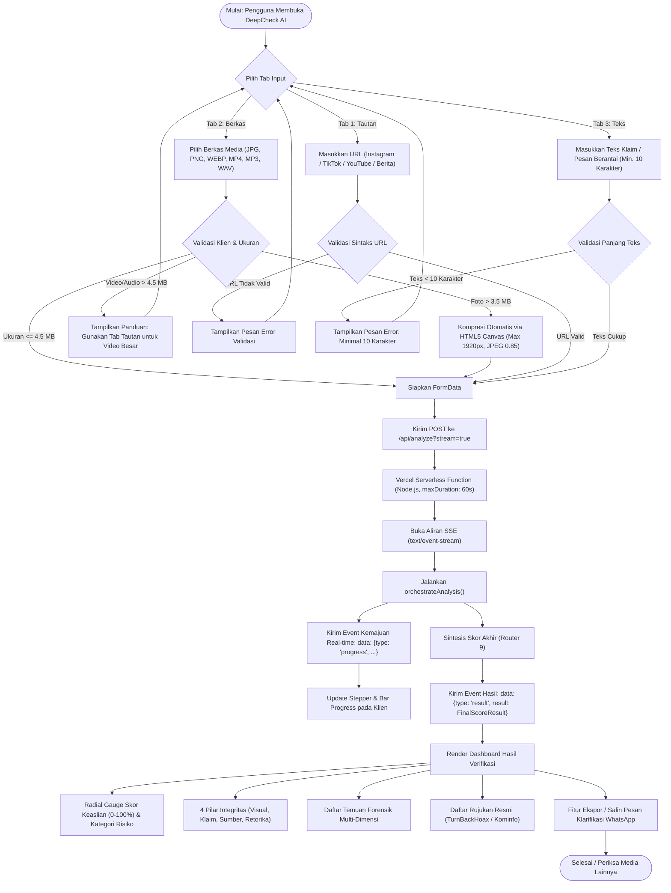
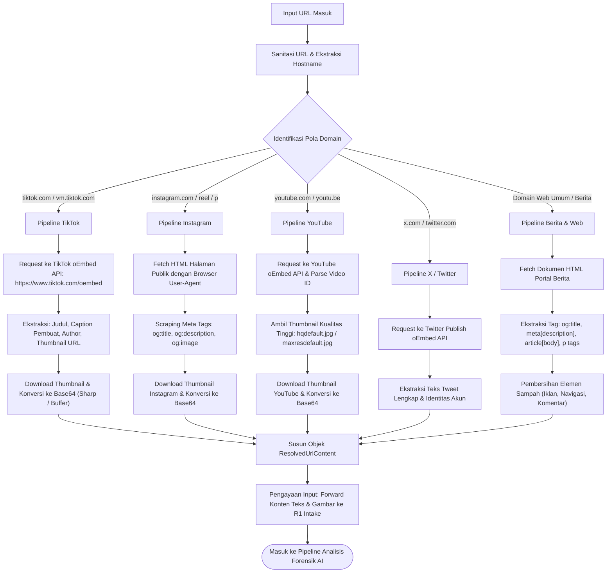
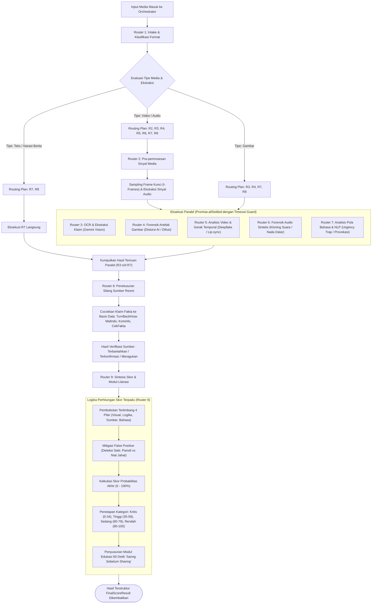
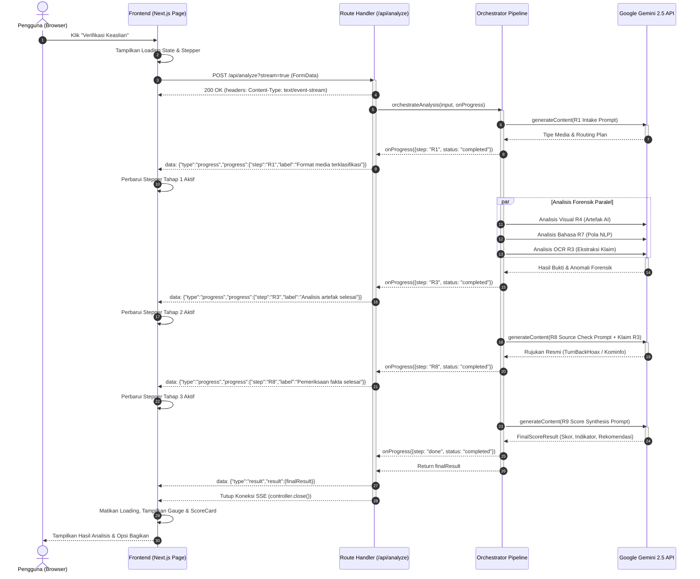
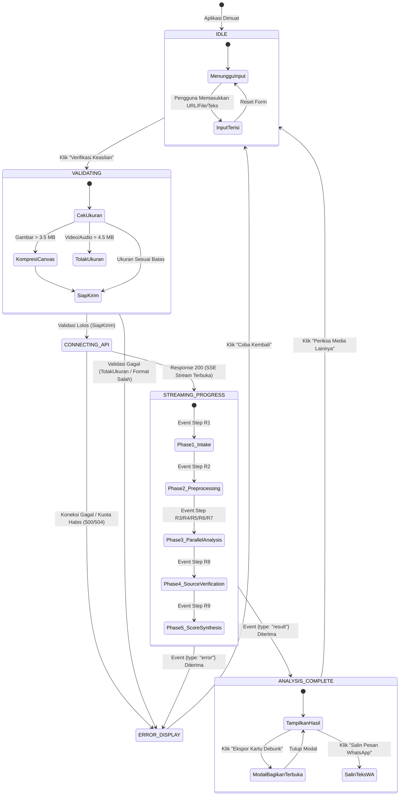

# 📊 Dokumentasi Diagram Alir (Flowcharts) — DeepCheck AI

Dokumentasi ini memetakan seluruh alur kerja sistem, logika pengambilan keputusan kecerdasan buatan, proses pengurai tautan media sosial, serta komunikasi *real-time* berbasis *Server-Sent Events* (SSE) pada platform **DeepCheck AI**.

---

## 📑 Daftar Diagram

1. [Diagram 1: Flowchart Sistem Menyeluruh (End-to-End System)](#1-flowchart-sistem-menyeluruh-end-to-end-system)
2. [Diagram 2: Flowchart Pengurai Tautan & Media Sosial (URL Resolver Pipeline)](#2-flowchart-pengurai-tautan--media-sosial-url-resolver-pipeline)
3. [Diagram 3: Flowchart Matriks Keputusan & Pipeline 9-Router AI](#3-flowchart-matriks-keputusan--pipeline-9-router-ai)
4. [Diagram 4: Sequence Diagram Streaming Real-Time SSE](#4-sequence-diagram-streaming-real-time-sse)
5. [Diagram 5: State Transition Diagram (State Machine Status Verifikasi)](#5-state-transition-diagram-status-verifikasi)

---

## 1. Flowchart Sistem Menyeluruh (End-to-End System)

Diagram ini mengilustrasikan perjalanan data mulai dari interaksi pengguna di antarmuka web, validasi peramban, pengiriman ke *API Route Handler*, pemrosesan di orkestrator multi-jalur, hingga rendering hasil analitik ke layar pengguna.

---

## 2. Flowchart Pengurai Tautan & Media Sosial (URL Resolver Pipeline)

Diagram ini merinci algoritma modul [`url-resolver.ts`](file:///c:/Users/Renno/Desktop/deepcheck/src/lib/url-resolver.ts) dalam mengidentifikasi platform tautan dan mengekstrak materi digital yang dibutuhkan oleh AI tanpa memerlukan token API pihak ketiga yang berbayar.

---

## 3. Flowchart Matriks Keputusan & Pipeline 9-Router AI

Diagram ini memetakan arsitektur orkestrasi 9 router forensik kecerdasan buatan ([`orchestrator.ts`](file:///c:/Users/Renno/Desktop/deepcheck/src/routers/orchestrator.ts)). Sistem menentukan jalur evaluasi dinamis (*dynamic routing plan*) berdasarkan modalitas konten dan mengeksekusi analisis secara paralel dengan pelindung *timeout*.

---

## 4. Sequence Diagram Streaming Real-Time SSE

Diagram urutan ini menggambarkan pertukaran pesan secara asinkron antara *Browser Klien*, *Next.js Serverless Route*, *Orchestrator*, dan *Google Gemini AI API* menggunakan teknologi *Server-Sent Events* (SSE).

---

## 5. State Transition Diagram (Status Verifikasi)

Diagram mesin keadaan (*state machine*) berikut memetakan transisi status antarmuka pengguna pada komponen [`page.tsx`](file:///c:/Users/Renno/Desktop/deepcheck/src/app/page.tsx) sepanjang siklus hidup analisis media:

---

  <b>DeepCheck AI • Dokumentasi Resmi Arsitektur Sistem</b> 
  PTIK Kelompok 4 • Program Studi Informatika • 2026

